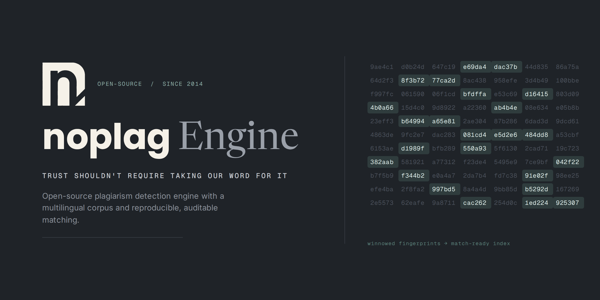

<p align="center">
  
</p>

<h1 align="center">VeriScholar AI</h1>

<p align="center">
  <strong>Open-source research plagiarism detection platform.</strong><br>
  Built on <a href="https://github.com/NoplagLabs/noplag-engine">Noplag Engine</a> · Scholarly corpus ingestion · Hybrid matching · Transparent scoring.
</p>

<p align="center">
  
  
  
  
  
</p>

---

VeriScholar AI transforms the [Noplag Engine](https://github.com/NoplagLabs/noplag-engine) into a research-oriented plagiarism detection platform for universities, journal publishers, and research institutions. It adds scholarly corpus ingestion from major academic databases, three-layer hybrid detection (exact, fuzzy, semantic), and a modern React/TypeScript interface — all running on your own infrastructure.

### What's different from the base engine

| Capability | Noplag Engine | VeriScholar AI |
|---|---|---|
| Detection method | Verbatim fingerprinting (L0/L1) | **Exact + Fuzzy** in the live pipeline (L0–L2); Semantic (L3) implemented, wiring tracked separately |
| Corpus sources | Manual upload only | **OpenAlex · arXiv · CORE · PubMed · Crossref** |
| Scoring | Single similarity % | **Transparent hybrid** with per-layer breakdown |
| Metadata | Filename only | **DOI, authors, abstract, year, journal, license** |
| Deduplication | Content hash | **DOI + source ID + title/year** (3-layer) |
| UI | Bare HTML demo | **React/TypeScript** SPA with report visualization |
| API | Checks + corpus | **+ scholarly ingest, corpus search, job management** |

### Three commitments (inherited from Noplag Engine)

- **Auditable** — Apache-2.0. Read it, fork it, self-host it. No black box.
- **Honest** — every match shows its source. Similarity ≠ plagiarism — the system reports evidence, not verdicts.
- **Yours** — your documents never leave your infrastructure.

## Quick start

```sh
git clone https://github.com/NoplagLabs/noplag-engine
cd noplag-engine
docker compose up
```

First run migrates the schema and indexes the bundled sample corpus (~1,000 Wikipedia articles). Then:

- **http://localhost:8000/docs** — interactive OpenAPI docs with the full `/v1` API.
- **http://localhost:8000** — original demo page.

### Frontend (React UI)

```sh
cd frontend
npm install
npm run dev
# → http://localhost:5173
```

The Vite dev server proxies API calls to the FastAPI backend at `:8000`.

## How it works

### Detection cascade

```
┌──────────────┐    ┌──────────────┐    ┌──────────────┐    ┌──────────────┐
│  L1: Winnow  │ →  │  L0: Align   │ →  │  L2: Fuzzy   │ →  │ L3: Semantic │
│   GIN index  │    │ seed-extend  │    │ Jaccard/Dice │    │  FAISS/SBERT │
│  exact fps   │    │ char ranges  │    │  token/ngram │    │  embeddings  │
└──────────────┘    └──────────────┘    └──────────────┘    └──────────────┘
                              ↓
                    ┌──────────────────┐
                    │  Hybrid Scorer   │
                    │  configurable    │
                    │  weights (50/25/ │
                    │  25 default)     │
                    └──────────────────┘
```

1. **L1 — Winnowing retrieval**: sentence-window chunks are reduced to [winnowing fingerprints](https://theory.stanford.edu/~aiken/publications/papers/sigmod03.pdf) stored as GIN-indexed `bigint[]` arrays in Postgres. Candidates sharing fingerprints are retrieved in bulk.
2. **L0 — Seed-and-extend alignment**: hash-indexed exact substring seeding followed by tolerant lookahead extension. Produces precise character-level offsets on both sides.
3. **L2 — Fuzzy matching**: token Jaccard, character n-gram Dice coefficient, and LCS ratio catch near-verbatim modifications (synonym substitution, word reordering, filler insertion). Runs inside the live check pipeline on L1 candidates that seed-extend produced no verbatim passage for — i.e. a passage that shares fingerprints with a source but was lightly paraphrased. Matches are reported with `match_type="fuzzy"` so the evidence is distinguishable from verbatim. Toggle with `NOPLAG_FUZZY_ENABLED`; tune the reporting cutoff with `NOPLAG_FUZZY_THRESHOLD` (default `0.4`).
4. **L3 — Semantic retrieval** *(implemented, not yet wired into the automatic pipeline)*: Sentence Transformers encode passages into dense vectors, FAISS provides approximate nearest-neighbor search, optional cross-encoder reranking refines top candidates. The `semantic/` module and `scoring/` hybrid combiner are built and unit-tested; wiring them into `run_check` requires a passage-embedding index build step over the corpus (tracked separately). Until then, heavy paraphrase and cross-language reuse remain out of scope — see Limitations.

The verbatim (L0/L1) and fuzzy (L2) layers feed the report today; the **transparent hybrid scorer** (`scoring/`) combines per-layer evidence with configurable weights once the semantic layer is wired in. Each layer's contribution is reported separately — no opaque "AI score."

## Scholarly corpus ingestion

Ingest research papers from five academic sources:

| Source | Coverage | Access | What you get |
|---|---|---|---|
| **OpenAlex** | 250M+ works | Free (polite email) | Metadata + OA links |
| **arXiv** | 2.4M+ preprints | Free | Full-text PDF + metadata |
| **Crossref** | 140M+ DOIs | Free (polite email) | DOI metadata |
| **CORE** | 300M+ outputs | Free / API key | OA full text |
| **PubMed Central** | 9M+ articles | Free (email) | JATS XML full text |

```sh
# Ingest via API
curl -X POST http://localhost:8000/v1/scholarly/ingest \
  -H 'Content-Type: application/json' \
  -d '{"source": "openalex", "query": "machine learning", "max_results": 100}'

# Or use the React UI: Scholarly Ingest → fill form → Start Ingestion
```

The pipeline handles:
- **Discovery** — query the source API with search criteria
- **Deduplication** — 3-layer dedup (DOI → source ID → normalized title + year)
- **Download** — fetch full-text PDFs for open-access papers
- **Ingestion** — extract text, store metadata, compute fingerprints
- **Job tracking** — resumable jobs with progress counters

## Bring your own corpus

The original ingestion methods still work:

```sh
# A folder of .txt / .md / .pdf / .docx
DATABASE_URL=... python scripts/ingest_folder.py /path/to/documents

# One file over HTTP
curl -F "file=@paper.pdf" http://localhost:8000/v1/corpus/documents
```

## API in 30 seconds

```sh
# Submit a check
curl -s -X POST http://localhost:8000/v1/checks \
  -H 'Content-Type: application/json' \
  -d '{"query_text": "Text to check, at least a few sentences long..."}'
# → {"check_id": "...", "status_url": ..., "report_url": ...}

# Poll status, then fetch the report
curl -s http://localhost:8000/v1/checks/<id>
curl -s http://localhost:8000/v1/checks/<id>/report

# Corpus statistics
curl -s http://localhost:8000/v1/scholarly/stats

# List ingestion jobs
curl -s http://localhost:8000/v1/scholarly/jobs
```

Full API surface served live at `/docs`.

## Configuration

All settings are environment-variable-driven with sensible defaults. Key variables:

| Variable | Default | Description |
|---|---|---|
| `VS_PRODUCT_NAME` | `VeriScholar AI` | Product name in API docs/reports |
| `VS_OPENALEX_EMAIL` | *(empty)* | Email for OpenAlex polite pool |
| `VS_CROSSREF_EMAIL` | *(empty)* | Email for Crossref polite pool |
| `VS_CORE_API_KEY` | *(empty)* | CORE API key for bulk access |
| `VS_SEMANTIC_MODEL` | `all-MiniLM-L6-v2` | Sentence Transformer model |
| `VS_DEVICE` | `cpu` | Embedding device (`cpu` / `cuda`) |
| `VS_EXACT_WEIGHT` | `0.50` | Hybrid score: exact match weight |
| `VS_FUZZY_WEIGHT` | `0.25` | Hybrid score: fuzzy match weight |
| `VS_SEMANTIC_WEIGHT` | `0.25` | Hybrid score: semantic match weight |
| `VS_CORS_ORIGINS` | `localhost:3000,5173` | CORS allowed origins |
| `VS_AUTH_ENABLED` | `0` | Enable JWT authentication |

See [.env.example](.env.example) for the full list.

## Development

Requires **Python 3.12+** and **Node 18+**.

```sh
# Backend
python3.12 -m venv .venv && source .venv/bin/activate
pip install -e ".[dev]"
docker compose up postgres -d   # tests skip DB-bound suites without it
pytest -q

# Frontend
cd frontend && npm install && npm run dev

# Optional: semantic layer
pip install -e ".[semantic]"  # installs sentence-transformers + faiss-cpu + torch
```

## Benchmarks

Evaluated with the standard plagdet metric on [PAN-PC-11](https://zenodo.org/records/3250095):

- **Verbatim / light obfuscation**: plagdet **0.8+**, precision ≥ 0.95
- **Moderate paraphrase (synonym swaps, reordering)**: caught by the L2 fuzzy layer when the source still shares fingerprints — i.e. retrieval reaches it but seed-extend finds no exact run. This is the recall the fuzzy layer adds over the exact-only pipeline.
- **Heavy paraphrase / cross-language**: still near zero. Surface token/n-gram overlap cannot separate heavy paraphrase from independently written prose on the same topic without false positives; that gap needs the L3 semantic layer, which is implemented but not yet wired into the automatic pipeline.

The eval harness is in [eval/](eval/).

## Layout

```
src/noplag_engine/
├── api/                  # FastAPI routes (checks, corpus, scholarly)
├── alignment/            # L0 seed-and-extend aligner
├── chunking/             # Sliding-sentence chunker
├── fingerprinting/       # Winnowing fingerprint generation
├── retrieval/            # L1 GIN-index candidate retrieval
├── fuzzy/                # L2 token Jaccard, n-gram Dice, LCS
├── semantic/             # L3 Sentence Transformers + FAISS
├── scoring/              # Transparent hybrid scorer
├── scholarly/            # Scholarly API clients + ingestion pipeline
│   ├── openalex.py       #   OpenAlex (250M+ works)
│   ├── arxiv.py          #   arXiv preprints
│   ├── crossref.py       #   Crossref DOI metadata
│   ├── core.py           #   CORE open-access full text
│   ├── pubmed.py         #   PubMed Central biomedical literature
│   ├── pipeline.py       #   Ingestion orchestrator
│   └── dedup.py          #   3-layer deduplication
├── ingestion/            # Text extraction, storage, language detection
├── workflows/            # Check + corpus orchestration
├── vs_config.py          # VeriScholar configuration
└── demo/                 # Original HTML demo page

frontend/                 # React/TypeScript SPA (Vite)
├── src/pages/            #   Dashboard, NewCheck, Report, History,
│                         #   CorpusManager, ScholarlyIngest, Settings
├── src/components/       #   Sidebar, ScoreRing, HighlightedText
└── src/api.ts            #   Type-safe API client

migrations/               # Alembic schema migrations
eval/                     # PAN-PC-11 benchmark harness
data/                     # Bundled sample corpus
```

## License

[Apache-2.0](LICENSE). The sample corpus texts are from English Wikipedia and remain CC BY-SA 4.0. VeriScholar AI builds upon the [Noplag Engine](https://github.com/NoplagLabs/noplag-engine) (Apache-2.0).
