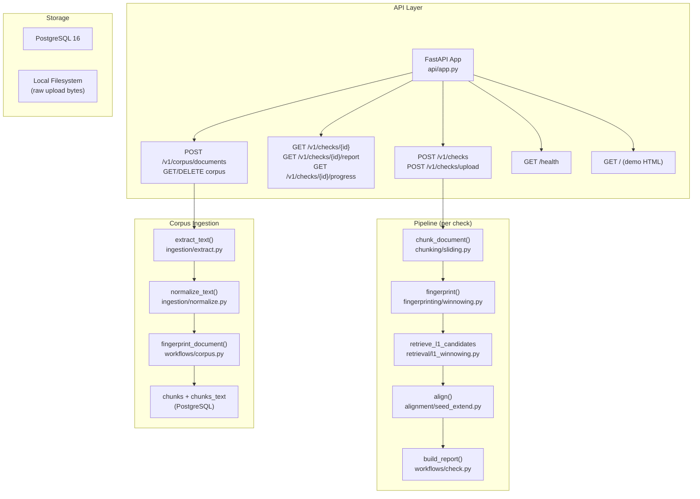

# Noplag Engine — Repository Audit & VeriScholar AI Implementation Plan

## Phase 1 Complete: Repository Audit

### Repository Overview

| Property | Value |
|---|---|
| **License** | Apache-2.0 |
| **Language** | Python 3.12+ |
| **Framework** | FastAPI + SQLAlchemy (async) + PostgreSQL |
| **Detection** | Winnowing fingerprints (L1) + Seed-extend alignment (L0) |
| **Frontend** | Static HTML demo page (minimal) |
| **Docker** | Single `docker-compose.yml`: Postgres 16 + engine |
| **Tests** | 15 test files, pytest + pytest-asyncio |
| **Eval** | PAN-PC-11 benchmark harness |
| **Version** | 0.1.0 |

---

### Architecture Map

---

### Verified Features (What Exists)

| Feature | Status | Location |
|---|---|---|
| Winnowing fingerprint algorithm | ✅ Working | [winnowing.py](file:///home/yashraj/YASHRAJ/noplag-engine/src/noplag_engine/fingerprinting/winnowing.py) |
| Sliding-sentence chunking | ✅ Working | [sliding.py](file:///home/yashraj/YASHRAJ/noplag-engine/src/noplag_engine/chunking/sliding.py) |
| L1 GIN-indexed retrieval | ✅ Working | [l1_winnowing.py](file:///home/yashraj/YASHRAJ/noplag-engine/src/noplag_engine/retrieval/l1_winnowing.py) |
| L0 seed-extend alignment | ✅ Working | [seed_extend.py](file:///home/yashraj/YASHRAJ/noplag-engine/src/noplag_engine/alignment/seed_extend.py) |
| End-to-end check pipeline | ✅ Working | [check.py](file:///home/yashraj/YASHRAJ/noplag-engine/src/noplag_engine/workflows/check.py) |
| PDF / DOCX / TXT extraction | ✅ Working | [extract.py](file:///home/yashraj/YASHRAJ/noplag-engine/src/noplag_engine/ingestion/extract.py) |
| Text normalization | ✅ Working | [normalize.py](file:///home/yashraj/YASHRAJ/noplag-engine/src/noplag_engine/ingestion/normalize.py) |
| Language detection | ✅ Working | [language.py](file:///home/yashraj/YASHRAJ/noplag-engine/src/noplag_engine/ingestion/language.py) |
| Document fingerprinting workflow | ✅ Working | [corpus.py](file:///home/yashraj/YASHRAJ/noplag-engine/src/noplag_engine/workflows/corpus.py) |
| Checks API (CRUD + SSE progress) | ✅ Working | [checks.py](file:///home/yashraj/YASHRAJ/noplag-engine/src/noplag_engine/api/v1/checks.py) |
| Corpus API (upload/list/delete) | ✅ Working | [corpus.py](file:///home/yashraj/YASHRAJ/noplag-engine/src/noplag_engine/api/v1/corpus.py) |
| Batch retrieval + time budgets | ✅ Working | l1_winnowing.py batched |
| Stop-fingerprint filtering | ✅ Working | [stop_list.py](file:///home/yashraj/YASHRAJ/noplag-engine/src/noplag_engine/retrieval/stop_list.py) |
| Document frequency table | ✅ Working | [fingerprint_df.py](file:///home/yashraj/YASHRAJ/noplag-engine/src/noplag_engine/retrieval/fingerprint_df.py) |
| Object storage abstraction | ✅ Working | [storage.py](file:///home/yashraj/YASHRAJ/noplag-engine/src/noplag_engine/ingestion/storage.py) |
| Alembic migrations | ✅ Working | [0001_initial.py](file:///home/yashraj/YASHRAJ/noplag-engine/migrations/versions/0001_initial.py) |
| Docker Compose deployment | ✅ Working | [docker-compose.yml](file:///home/yashraj/YASHRAJ/noplag-engine/docker-compose.yml) |
| PAN-PC-11 evaluation harness | ✅ Working | [eval/](file:///home/yashraj/YASHRAJ/noplag-engine/eval) |
| Sample Wikipedia corpus | ✅ Working | ~1000 articles in data/ |
| Deduplication (SHA-256 + source_url) | ✅ Working | Migration + corpus workflow |
| Multiprocess alignment | ✅ Working | ProcessPoolExecutor in check.py |
| Path traversal protection | ✅ Working | storage.py path normalization |

### Database Schema (Verified)

| Table | Purpose | Key Columns |
|---|---|---|
| `tenants` | Multi-tenancy | id, name |
| `documents` | Corpus documents | id, tenant_id, source_type, source_url, filename, extracted_text, sha256, fingerprint_status |
| `chunks` | Fingerprinted chunks | id, document_id, tenant_id, fingerprints (bigint[] GIN) |
| `chunks_text` | Chunk text (narrow heap) | chunk_id, text |
| `checks` | Plagiarism checks | id, tenant_id, status, query_text, overall_similarity_pct, coverage |
| `check_results` | Per-source results | check_id, source_document_id, passages (jsonb) |
| `fingerprint_df` | Document frequencies | fingerprint, document_frequency (optional, built by script) |

### Enum Types
- `corpus_source_type`: `'user_upload', 'folder_import', 'wikipedia', 'web'`

---

### What Does NOT Exist (Gaps to Fill)

| Gap | Priority | Notes |
|---|---|---|
| **Scholarly corpus ingestion** (OpenAlex, arXiv, CORE, PubMed, Crossref) | 🔴 Critical | No scholarly data sources. Only local file upload and Wikipedia sample |
| **Semantic/paraphrase detection** | 🔴 Critical | Only verbatim/near-verbatim. No embeddings, no FAISS, no Sentence Transformers |
| **Fuzzy matching** (token similarity, n-gram, sequence alignment beyond seed-extend) | 🔴 Critical | Seed-extend handles near-verbatim; nothing for light paraphrase |
| **Modern web frontend** | 🟡 High | Only a bare HTML demo page. No React, no TypeScript |
| **Authentication/authorization** | 🟡 High | Explicitly single-tenant, no auth. README says "run on trusted network" |
| **Scholarly metadata** (DOI, authors, abstract, publication year) | 🔴 Critical | `documents` table has no DOI/authors/abstract/year columns |
| **PDF report generation** | 🟡 High | Only JSON reports via API |
| **OCR for scanned PDFs** | 🟢 Medium | pypdf only reads text layer; no OCR fallback |
| **Reference/bibliography detection** | 🟢 Medium | No section detection; bibliography indexed as body text |
| **Page-level location mapping** | 🟢 Medium | Char offsets exist but no PDF page mapping |
| **Redis/background job queue** | 🟢 Medium | Uses FastAPI BackgroundTasks (single process) |
| **Rate limiting** | 🟡 High | None |
| **CORS configuration** | 🟡 High | Default FastAPI (no CORS headers) |
| **Audit logging** | 🟢 Medium | Only Python logging; no structured audit trail |
| **Configurable branding** | 🟢 Low | Hardcoded "Noplag Engine" |
| **Cross-encoder reranking** | 🟢 Medium | No ML reranking |
| **Hybrid scoring/ranking** | 🔴 Critical | Only verbatim match score; no combined scoring |
| **Corpus statistics dashboard** | 🟡 High | Check stats exist but no corpus coverage metrics |
| **Backup/restore instructions** | 🟢 Medium | Not documented |
| **GPU acceleration** | 🟢 Low | Not applicable to current engine; will matter for embeddings |

---

## Implementation Plan

### Phase 2: Architecture & Database (Next)

1. Add new database migration for scholarly metadata:
   - Extend `documents` with: doi, authors (jsonb), abstract, publication_year, journal, license, source_api, full_text_available
   - Add `corpus_source_type` enum values: `'openalex', 'arxiv', 'core', 'pubmed', 'crossref'`
   - Create `scholarly_ingestion_jobs` table for tracking ingestion pipeline state
   - Add `semantic_embeddings` table for FAISS vector storage metadata

2. Extend `config.py` with VeriScholar-specific settings (branding, API keys, thresholds)

3. Add Redis service to `docker-compose.yml` for background jobs

### Phase 3: Scholarly Corpus Ingestion

1. Build API client modules for: OpenAlex, arXiv, CORE, PubMed Central, Crossref
2. Implement discovery (search by topic, keywords, DOI, author, year)
3. Full-text download with license compliance checking
4. Deduplication via DOI + normalized title + content hash
5. Ingestion status tracking, retry logic, rate limiting
6. Corpus statistics and coverage metrics

### Phase 4: Hybrid Matching & Semantic Retrieval

1. **Preserve** existing winnowing + seed-extend (L0/L1)
2. Add fuzzy matching layer (token Jaccard, n-gram similarity)
3. Add semantic embedding pipeline (Sentence Transformers)
4. FAISS vector index for passage-level semantic retrieval
5. Cross-encoder reranking for top candidates
6. Hybrid scoring with configurable weights

### Phase 5: Frontend & Reports

1. React + TypeScript web application
2. Dashboard, upload, progress, report, corpus management pages
3. Highlighted passage display with source attribution
4. PDF report generation
5. Clean academic design (no excessive decoration)

### Phase 6: Security & Operations

1. JWT authentication + user management
2. CORS, rate limiting, file validation
3. Role-based access control
4. Audit logging
5. Secure deployment configuration

### Phase 7: Benchmarking & Documentation

1. Extended evaluation framework (exact, fuzzy, semantic, paraphrase)
2. Baseline vs. enhanced comparison
3. Comprehensive documentation
4. Deployment guides for Ubuntu/Fedora

---

> [!IMPORTANT]
> The existing Noplag engine is well-architected and production-grade for verbatim detection. The plan preserves all working functionality and adds layers incrementally. No existing code will be removed without justification.
